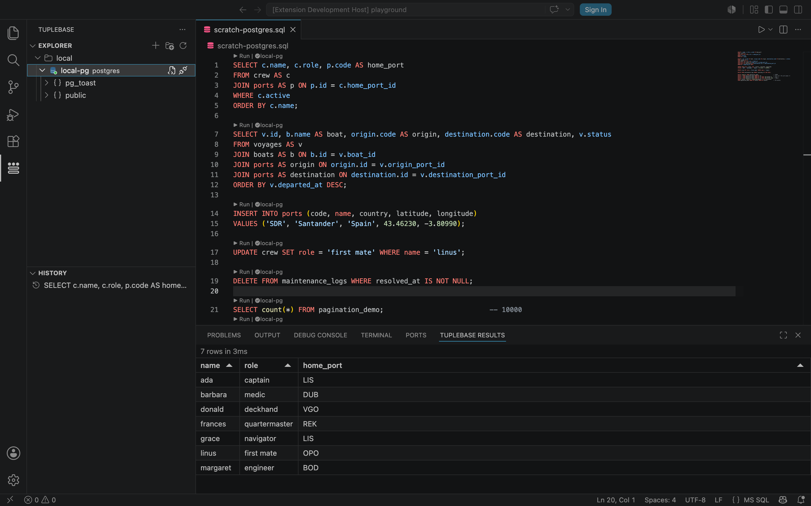

 

### Your database workspace, inside VS Code.

Explore schemas, write queries, inspect results, and revisit query history without leaving your editor. Works with PostgreSQL, MySQL, and MariaDB, with [more engines in development](docs/DATABASES.md).

[Install from the VS Code Marketplace](https://marketplace.visualstudio.com/items?itemName=tuplebase.tuplebase) · [Install from Open VSX](https://open-vsx.org/extension/tuplebase/tuplebase)

## Docs

- [Features](docs/FEATURES.md)
- [Install and get started](docs/INSTALL.md)
- [Supported databases](docs/DATABASES.md)
- [MCP server for AI agents](docs/MCP.md)
- [Security and data handling](SECURITY.md)
- [Changelog](CHANGELOG.md)
- [Local development](docs/DEVELOPMENT.md)
- [Testing](docs/TESTING.md)
- [Architecture](docs/ARCHITECTURE.md)

## Support

Report bugs and request features through [GitHub Issues](https://github.com/TupleBase/tuplebase-vscode/issues). For other questions, contact [hello@tuplebase.app](mailto:hello@tuplebase.app).

TupleBase is free and open source. If it saves you time, [sponsor the project on GitHub](https://github.com/sponsors/TupleBase).

## License

[MIT](LICENSE). Third-party components and their licenses are listed in [THIRD-PARTY-NOTICES](THIRD-PARTY-NOTICES). Database logos come from [devicon](https://github.com/devicons/devicon) (MIT); database names and logos are trademarks of their respective owners and are used to indicate compatibility.
